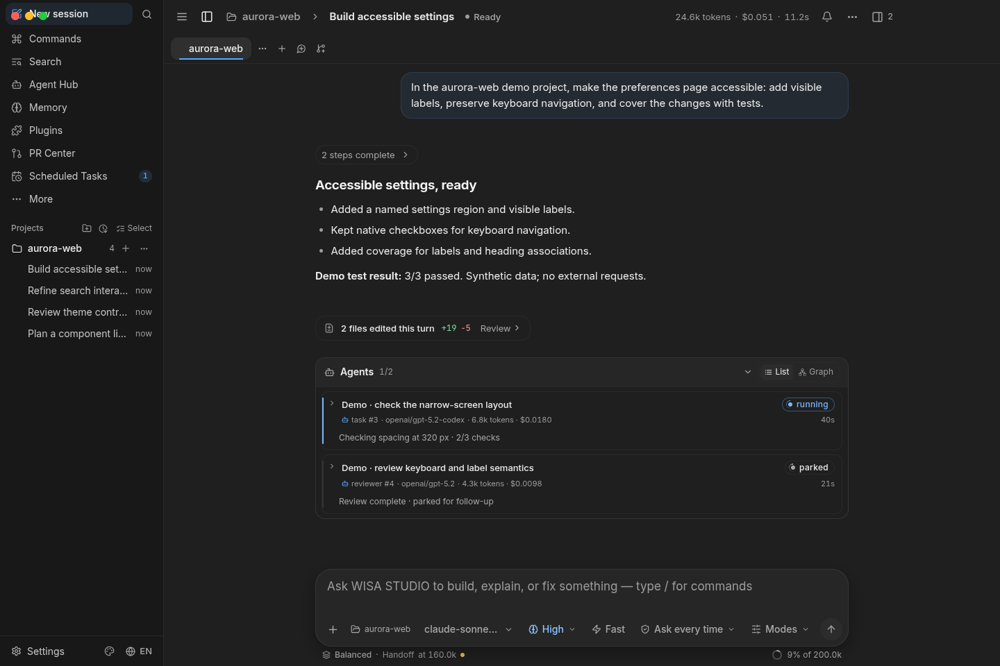

# WISA STUDIO

**Fork of oh-my-pi (MIT). UI rebrand by WISA.**

Vietnamese-first desktop GUI for oh-my-pi (omp) — an install-and-go coding agent with parallel sessions in one window and a pre-wired WISA gateway so a single API key reaches every model. Electron, for macOS, Windows and Linux.



## Download

| Platform | Package |
|---|---|
| macOS Apple Silicon | `wisa-studio-0.9.47-arm64.dmg` — [release page](https://github.com/smokeyduck/wisa-studio/releases/tag/v0.9.47) |
| macOS Intel | `wisa-studio-0.9.47.dmg` — [release page](https://github.com/smokeyduck/wisa-studio/releases/tag/v0.9.47) |
| Windows x64 | [`wisa-studio-0.9.47-setup.exe`](https://github.com/smokeyduck/wisa-studio/releases/download/v0.9.47/wisa-studio-0.9.47-setup.exe) |
| Linux x64 | [`wisa-studio-0.9.47.AppImage`](https://github.com/smokeyduck/wisa-studio/releases/download/v0.9.47/wisa-studio-0.9.47.AppImage) |

[All releases](https://github.com/smokeyduck/wisa-studio/releases) · [Install guide (vi)](docs/vi/cai-dat.md)

macOS builds are ad-hoc signed (not notarized) and Windows builds are unsigned, so the first launch may need confirmation: macOS → right-click → **Open**, or System Settings → Privacy & Security → **Open Anyway**; Windows → **More info** → **Run anyway**.

## Get an API key

WISA STUDIO seeds a `wisa` provider pointing at `https://api.askwisa.com/v1`. One key covers every model the gateway serves, and the model list is fetched automatically once the key is saved.

**[Get an API key at askwisa.com →](https://askwisa.com/?utm_source=github&utm_medium=readme)**

Optional: Anthropic, OpenAI, DeepSeek, OpenRouter, Gemini and anything else the upstream agent supports still work. See the [provider guide (vi)](docs/vi/nha-cung-cap-wisa.md) and the [FAQ (vi)](docs/vi/faq.md).

<div align="center">

[](https://github.com/smokeyduck/wisa-studio/releases)
[](https://github.com/smokeyduck/wisa-studio/releases)
[](./LICENSE)


[English](README.en.md) · [Tiếng Việt](README.md)

</div>

---

## How WISA STUDIO differs from omp

The agent is unchanged. All the work — reading files, running commands, editing code, calling tools, MCP, Skills — is oh-my-pi's binary, compiled unmodified from the commit in [`sidecar-source.json`](sidecar-source.json) and shipped inside the app. WISA replaces the presentation layer and the packaging:

- **Name and identity:** WISA STUDIO in window titles, the tray, macOS permission prompts and installer artifact names.
- **Vietnamese by default:** five interface languages (Tiếng Việt, English, 中文, Русский, ไทย); this build opens in Vietnamese.
- **WISA gateway:** the `wisa` provider is pre-seeded and offered first in onboarding.
- **Releases:** published from this repository.

Because it shares `~/.omp`, sessions and settings stay compatible with the omp CLI: the same session opens from a terminal or from the GUI.

## What the interface does

- **Parallel sessions:** each tab is its own agent process; background work keeps running while you switch, and restored tabs start only when opened.
- **Split panes and multiple windows:** two sessions side by side or stacked, a draggable divider, layout restored across restarts.
- **Workspace:** directory tree, file tabs, edit with `⌘S`, Markdown source/preview, diffs and logs.
- **Scheduled tasks:** cron or interval, running in the background with run history, reports and a verification step.
- **Session overview:** context by category, cost, cache, speed, running subagents and MCP servers.
- **MCP, Skills, plugins, hooks:** managed from Settings instead of hand-edited JSON.
- **SSH hosts, custom themes, command palette, voice mode, relay collaboration.**

Known limits: separate tabs are not an OS security boundary; a split holds two panes, not an unlimited grid; approvals and security scans are not a sandbox. Model requests still go to the provider you configure.

## Install

Download the package above, open it, paste an API key (or pick another provider) and you are working. No Node, Bun or omp CLI install is required — the agent ships inside the app.

Per-platform details, resetting data and first-launch troubleshooting: [docs/vi/cai-dat.md](docs/vi/cai-dat.md).

## Development

This repository is the GUI repo. The agent lives in the upstream monorepo and is compiled into a sidecar; to build the sidecar from source, clone the monorepo as a sibling directory and run:

```bash
bun install
bun run build:omp          # → resources/omp (arm64)
bun run build:omp:x64      # → resources/omp.x64 (Intel)
bun run build:omp:win      # → resources/omp.exe
bun run build              # → out/
bun run dev                # HMR; probes for a sidecar when none is built
```

Checks before a pull request:

```bash
bunx vitest run
bun run check:types
bunx biome check .
bun run check:locale       # ru + vi cover every setting the sidecar ships
bun run build
```

`bun run dev` is isolated from the installed app: `wisa-studio-dev` userData, `~/.omp-dev` agent profile, no `omp://` registration, no global shortcut.

## Packaging and releases

```bash
bun run package:mac:arm64 -- --publish never   # dist/wisa-studio-<ver>-arm64.dmg
bun run package:mac:x64   -- --publish never   # dist/wisa-studio-<ver>.dmg
bun run package:win       -- --publish never   # NSIS + portable
bun run package:linux     -- --publish never   # AppImage + deb
```

The full release runbook, including sidecar build order and artifact checks, is in [AGENTS.md](AGENTS.md) — read it before cutting a build. `appId` remains `sh.omp.gui` so existing users keep receiving updates; changing it is a separate, migration-bearing step (see [docs/vi/appid-va-cap-nhat.md](docs/vi/appid-va-cap-nhat.md)).

## License and credits

MIT — see [LICENSE](LICENSE). The original oh-my-pi copyright lines are kept verbatim.

- oh-my-pi (upstream): https://github.com/can1357/oh-my-pi
- The GUI layer this build is based on (MIT), with its original copyright lines: see [NOTICE](NOTICE).

WISA STUDIO is not affiliated with, endorsed by or sponsored by Anthropic, OpenAI, Google or any model provider. See [NOTICE](NOTICE).
