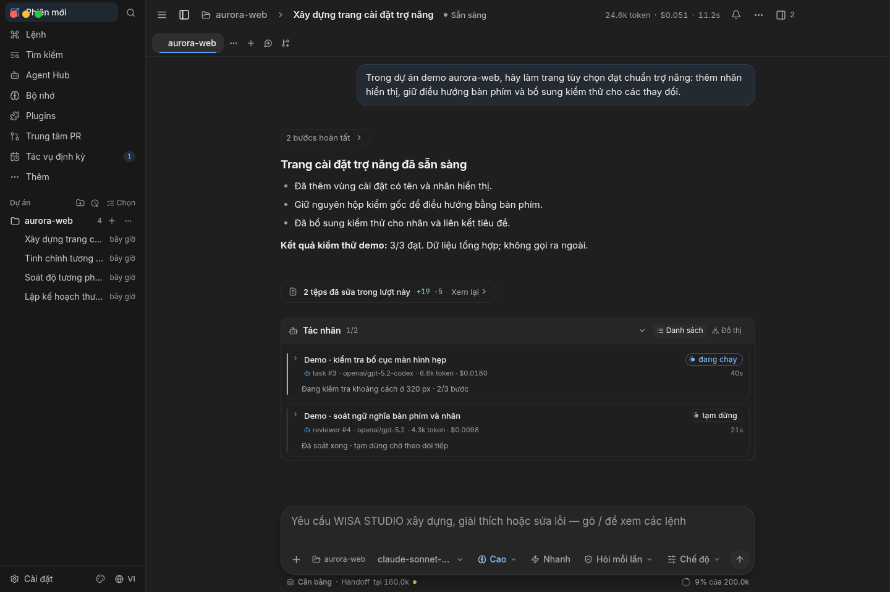

# WISA STUDIO

**Fork of oh-my-pi (MIT). UI rebrand by WISA.**

GUI desktop tiếng Việt cho oh-my-pi (omp) — trình coding agent cài một lần là chạy, nhiều phiên làm việc song song trong một cửa sổ, có sẵn cổng WISA để một API key dùng được mọi mô hình. Electron, cho macOS, Windows và Linux.



## Tải về

| Nền tảng | Gói |
|---|---|
| macOS Apple Silicon | `wisa-studio-0.9.54-arm64.dmg` — [trang phát hành](https://github.com/smokeyduck/wisa-studio/releases/tag/v0.9.54) |
| macOS Intel | `wisa-studio-0.9.54-x64.dmg` — [trang phát hành](https://github.com/smokeyduck/wisa-studio/releases/tag/v0.9.54) |
| Windows x64 | [`wisa-studio-0.9.54-setup.exe`](https://github.com/smokeyduck/wisa-studio/releases/download/v0.9.54/wisa-studio-0.9.54-setup.exe) |
| Linux x64 | [`wisa-studio-0.9.54.AppImage`](https://github.com/smokeyduck/wisa-studio/releases/download/v0.9.54/wisa-studio-0.9.54.AppImage) |

[Tất cả bản phát hành](https://github.com/smokeyduck/wisa-studio/releases) · [Hướng dẫn cài đặt](docs/vi/cai-dat.md)

Bản macOS được ký ad-hoc (chưa notarize) và bản Windows chưa ký, nên lần chạy đầu có thể phải xác nhận: macOS → chuột phải → **Open**, hoặc System Settings → Privacy & Security → **Open Anyway**; Windows → **More info** → **Run anyway**.

**Yêu cầu Windows:** Windows 10 x64 phiên bản 1809 (build 17763) trở lên, bao gồm Windows 11, và CPU x86-64-v2 có SSE4.2. Mức tối thiểu này dựa trên yêu cầu của Electron, Bun và native addon; không có nghĩa bản phát hành đã được kiểm thử trên máy Windows 10 thực tế.

### Hotfix 0.9.54

Bản cập nhật điều chỉnh thanh nhập trong khung hẹp và phím Tab hoàn thành gợi ý, tránh tải lại phiên lặp lại, đồng thời xoá cảnh báo chưa có mô hình sau khi chọn thành công. Engine đi kèm theo Core 19.1.1, vẫn giữ định tuyến theo họ mô hình Wisa, danh sách mô hình đã lưu đệm và các API được chỉ định rõ. Số đo bằng dữ liệu kiểm thử không chứng minh đã sửa độ trễ chuyển phiên thực tế được báo cáo. Xem chi tiết trong [CHANGELOG.md](CHANGELOG.md).

Bảng cài đặt tiếng Nga và tiếng Việt đã phủ đủ schema của Core đi kèm. Các bước kiểm tra phát hành chạy GUI đóng gói thật, đọc/ghi cài đặt qua IPC và kiểm tra lưu sau khi khởi động lại, gồm bản Windows đã cài bằng setup và tệp portable thực tế. Bản thử 0.9.53 trước đó chưa được công bố. Lỗi khởi động Windows được báo cáo chưa tái hiện được nên không tuyên bố đã sửa.

## Lấy API key

WISA STUDIO tạo sẵn nhà cung cấp `wisa` trỏ tới `https://api.askwisa.com/v1`. Một key dùng cho mọi mô hình mà cổng phục vụ, danh sách mô hình được lấy tự động sau khi lưu key.

**[Lấy API key tại askwisa.com →](https://askwisa.com/?utm_source=github&utm_medium=readme)**

Không bắt buộc: bạn vẫn có thể dùng Anthropic, OpenAI, DeepSeek, OpenRouter, Gemini… như upstream hỗ trợ. Xem [hướng dẫn cấu hình provider](docs/vi/nha-cung-cap-wisa.md) và [FAQ](docs/vi/faq.md).

<div align="center">

[](https://github.com/smokeyduck/wisa-studio/releases)
[](https://github.com/smokeyduck/wisa-studio/releases)
[](./LICENSE)


[English](README.en.md) · [Tiếng Việt](README.md)

</div>

---

## WISA STUDIO khác omp ở đâu

Agent không đổi. Toàn bộ phần "làm việc" — đọc file, chạy lệnh, sửa mã, gọi tool, MCP, Skills — là binary của oh-my-pi, biên dịch nguyên bản từ commit ghi trong [`sidecar-source.json`](sidecar-source.json) và đóng gói kèm ứng dụng. WISA chỉ thay lớp hiển thị và cách đóng gói:

- **Tên và nhận diện:** WISA STUDIO thay cho tên cũ trong tiêu đề cửa sổ, tray, hộp thoại cấp quyền của macOS, tên file cài đặt.
- **Tiếng Việt mặc định:** giao diện có 5 ngôn ngữ (Tiếng Việt, English, 中文, Русский, ไทย), bản này mở ra là tiếng Việt.
- **Cổng WISA:** provider `wisa` được tạo sẵn, xuất hiện đầu tiên trong onboarding.
- **Bản phát hành:** trỏ về repo này.

Dữ liệu của WISA STUDIO nằm riêng ở `~/.wisa-studio/agent` (không phải `~/.omp`), nên phiên và cấu hình không dùng chung với omp CLI.

## Giao diện có gì

- **Phiên song song:** mỗi tab là một tiến trình agent riêng, công việc nền chạy tiếp khi bạn chuyển tab; tab được khôi phục chỉ khởi động khi mở.
- **Chia đôi và nhiều cửa sổ:** đặt hai phiên cạnh nhau hoặc trên/dưới, kéo vách ngăn, khôi phục bố cục sau khi khởi động lại.
- **Không gian làm việc:** cây thư mục, tab file, sửa và lưu bằng `⌘S`, xem Markdown ở dạng nguồn hoặc đã render, xem diff và log.
- **Tác vụ định kỳ:** cron hoặc interval, chạy nền, có lịch sử chạy, báo cáo và bước xác minh.
- **Tổng quan phiên:** ngữ cảnh theo nhóm, chi phí, cache, tốc độ, subagent và MCP server đang chạy.
- **MCP, Skills, plugin, hook:** quản lý trong Cài đặt, không cần sửa JSON bằng tay.
- **SSH host, theme tuỳ chỉnh, command palette, chế độ giọng nói, cộng tác qua relay.**

Giới hạn cần biết: các tab không phải ranh giới bảo mật của hệ điều hành; chia đôi là hai khung, không phải lưới vô hạn; phê duyệt và quét bảo mật không thay cho sandbox. Request mô hình vẫn đi tới nhà cung cấp bạn cấu hình.

## Cài đặt

Tải gói ở trên, mở lên, dán API key (hoặc chọn provider khác) là dùng được. Không cần cài Node, Bun hay omp CLI — agent đã nằm trong gói.

Chi tiết theo từng nền tảng, cách đặt lại dữ liệu và xử lý lỗi khi mở app: [docs/vi/cai-dat.md](docs/vi/cai-dat.md).

## Vị trí dữ liệu và cùng tồn tại

WISA STUDIO giữ dữ liệu riêng và không đọc hay ghi `~/.omp`. Không có di chuyển dữ liệu tự động từ bản cũ.

| Dữ liệu | macOS | Windows | Linux |
|---|---|---|---|
| Cài đặt app, tab, lịch tác vụ, chỉ mục hội thoại, `logs/gui-runtime.jsonl` | `~/Library/Application Support/wisa-studio` | `%APPDATA%\wisa-studio` | `~/.config/wisa-studio` |
| Cấu hình agent: `models.yml`, MCP, skills, phiên | `~/.wisa-studio/agent` | `%USERPROFILE%\.wisa-studio\agent` | `~/.wisa-studio/agent` |
| Nhật ký agent | `~/.wisa-studio/logs` | `%USERPROFILE%\.wisa-studio\logs` | `~/.wisa-studio/logs` |
| Cấu hình dự án (trong thư mục làm việc) | `.wisa-studio/` | `.wisa-studio\` | `.wisa-studio/` |

Chạy phát triển (`bun run dev`) dùng `wisa-studio-dev` và `~/.wisa-studio-dev/agent`. Thư mục tạm của agent là `~/.wisa-studio-dev/tmp`.

Kiểm thử và tự động hóa có thể đặt `WISA_PROFILE_ROOT` (đường dẫn tuyệt đối) để chuyển toàn bộ dữ liệu trên sang `<root>/appData/wisa-studio` và `<root>/.wisa-studio/agent`. Đây là biến dành cho kiểm thử, không phải cách chọn thư mục dữ liệu tùy ý.

Các bản cũ lưu dữ liệu ở `…/omp` (userData) và `~/.omp` (agent). WISA STUDIO không sao chép, di chuyển hay xoá dữ liệu đó. API key đã lưu phải dán lại trong bản mới.

Cùng tồn tại:

- Với bản upstream `omp` (`productName: omp`, `appId: sh.omp.gui`) bản mới cài riêng: khác thư mục cài và định danh.
- Với bản WISA STUDIO cũ (`appId: sh.omp.gui`, `productName: WISA STUDIO`), bản mới trùng tên sản phẩm nên cùng đường dẫn `WISA STUDIO.app` (macOS) hoặc thư mục cài (Windows) và thay thế tệp ứng dụng cũ. Thư mục dữ liệu cũ không bị đụng tới; chỉ cài đường dẫn khác nếu cần chạy cả hai.
- Bản WISA cũ đọc cùng feed phát hành, nên trình tự cập nhật có thể cài bản mới tại chỗ. Cập nhật đó không mang theo dữ liệu: ứng dụng mở trên thư mục dữ liệu mới, còn key và quyền macOS gắn với định danh cũ không đi theo.
- Bản upstream `nornzach/oh-my-pi-gui` đọc feed riêng, không nhận bản WISA.
- WISA STUDIO không phải sandbox. Agent chạy với môi trường shell đăng nhập, PATH, cấu hình Git và SSH, và các thư mục làm việc bạn mở. Những thứ này được dùng chung có chủ ý.

## Phát triển

Repo này là GUI repo. Agent nằm ở monorepo upstream và được biên dịch thành sidecar; muốn dựng sidecar từ mã nguồn, clone monorepo vào thư mục anh em rồi:

```bash
bun install
bun run build:omp          # → resources/omp (arm64)
bun run build:omp:x64      # → resources/omp.x64 (Intel)
bun run build:omp:win      # → resources/omp.exe
bun run build              # → out/
bun run dev                # HMR; cần resources/omp (thiếu thì build từ monorepo kế bên; không có monorepo thì báo lỗi)
```

Kiểm tra trước khi gửi PR:

```bash
bunx vitest run
bun run check:types
bunx biome check .
bun run check:locale       # ru + vi phủ đủ mọi setting mà sidecar cung cấp
bun run build
```

`bun run dev` chạy tách biệt với bản đã cài: userData `wisa-studio-dev`, profile agent `~/.wisa-studio-dev/agent`, không đăng ký URL scheme với hệ điều hành, không chiếm phím tắt toàn cục.

Ghi đè chỉ dành cho phát triển, chỉ với bản chưa đóng gói: `OMP_BUNDLED_OMP=<path>` chạy binary đó thay cho `resources/omp`, và `OMP_SIDECAR=source` chạy mã nguồn coding-agent của monorepo qua bun. Bản đóng gói bỏ qua cả hai. App không kiểm tra rằng bản ghi đè hiểu `PI_CONFIG_SOURCES` / `PI_PROJECT_CONFIG_DIR` hay profile cách ly; dùng chúng là trách nhiệm của bạn.

## Đóng gói và phát hành

```bash
bun run package:mac:arm64 -- --publish never   # dist/wisa-studio-<ver>-arm64.dmg
bun run package:mac:x64   -- --publish never   # dist/wisa-studio-<ver>-x64.dmg
bun run package:win       -- --publish never   # NSIS + portable
bun run package:linux     -- --publish never   # AppImage + deb
```

Quy trình phát hành đầy đủ, gồm thứ tự build sidecar và kiểm tra gói, nằm trong [AGENTS.md](AGENTS.md) — đọc trước khi cắt bản. Định danh đóng gói và các bước cutover nằm trong [docs/vi/appid-va-cap-nhat.md](docs/vi/appid-va-cap-nhat.md).

## Giấy phép và ghi công

MIT — xem [LICENSE](LICENSE). Bản quyền gốc của oh-my-pi được giữ nguyên văn.

- oh-my-pi (upstream): https://github.com/can1357/oh-my-pi
- Lớp GUI gốc mà bản này dựa trên (MIT), cùng bản quyền gốc: xem [NOTICE](NOTICE).

WISA STUDIO không liên kết, không được bảo trợ bởi Anthropic, OpenAI, Google hay bất kỳ nhà cung cấp mô hình nào. Xem [NOTICE](NOTICE).
